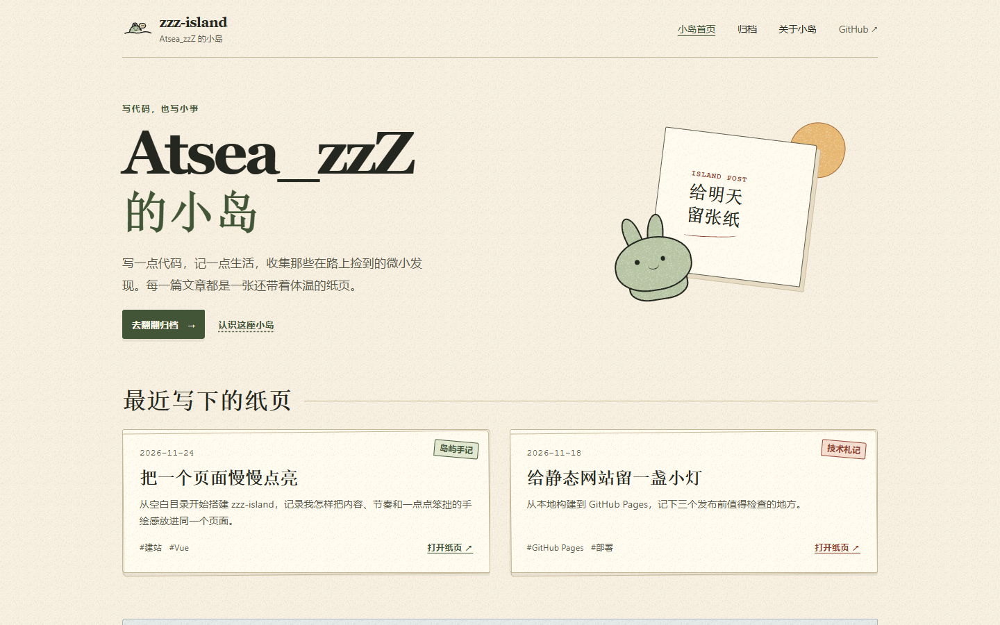

# zzz-island

Atsea_zzZ 的小岛，一个用 VitePress 写成的个人博客。内容以技术札记为主，也保留一些生活记录。页面使用暖纸色、手绘线条和原创的“岛屿信使”作为视觉线索。

## 网站预览

### 桌面端



### 移动端


## 本地开发

```bash
npm ci
npm run docs:dev
```

开发服务器启动后，打开终端提示的本地地址即可预览。文章内容位于 `posts/`，共享主题位于 `.vitepress/theme/`。

## 构建与预览

```bash
npm run docs:build
npm test
npm run docs:preview
```

生产文件生成在 `.vitepress/dist`。测试会检查首页、归档页、关于页和两篇示例文章是否被构建。

## GitHub Pages

站点使用 `AtseazzZ/atseazzz.github.io` 作为 GitHub Pages 用户站仓库，VitePress 的根路径是 `base: '/'`。推送到 `main` 或手动运行 `.github/workflows/deploy.yml` 时，GitHub Actions 会构建、检查并发布网站。

首次启用时，在仓库设置中打开 **Settings → Pages**，将构建来源设为 **GitHub Actions**。仓库公开后，站点地址为 `https://atseazzz.github.io/`。

## 发布新文章

把 Markdown 文件放在 `posts/` 目录下，填写以下文章信息。

```yaml
---
title: 文章标题
description: 首页卡片使用的摘要
date: '2026-11-24'
category: 技术札记
tags:
  - Vue
  - GitHub Pages
---
```

在 frontmatter 下用 Markdown 写正文。首页、归档页和上一篇／下一篇会在构建时按日期自动更新。

## 在线发布文章

仓库根目录的 `.pages.yml` 已配置 Pages CMS 文章编辑器。首次使用时，访问 [Pages CMS](https://app.pagescms.org/) 并用 GitHub 登录，授权应用访问 `AtseazzZ/atseazzz.github.io`，然后选择 `main` 分支。不要邀请其他 Pages CMS 协作者。任何拥有该仓库写入权限的账号都能发布文章。

在 Pages CMS 的「博客文章」集合中新建文章，填写标题、摘要、日期、作者、分类和标签，再用正文编辑器撰写 Markdown。插入图片时，图片会保存到 `public/images/posts/`，文章中会使用 `/images/posts/` 路径。保存后 CMS 会将更改提交到 GitHub，推送到 `main` 后由 GitHub Actions 自动构建和发布。
