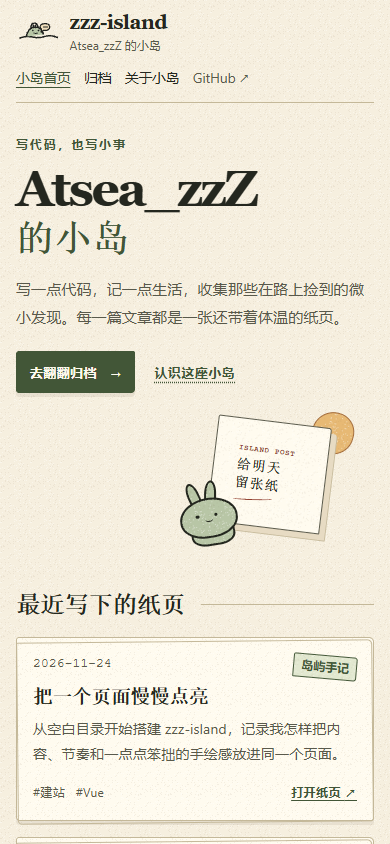

# zzz-island

Atsea_zzZ 的小岛，一个用 VitePress 写成的个人博客。内容以技术札记为主，也保留一些生活记录。页面使用暖纸色、手绘线条和原创的“岛屿信使”作为视觉线索。

## 网站预览

### 桌面端


### 移动端



## 本地开发

```bash
npm ci
npm run docs:dev
```

开发服务器启动后，打开终端提示的本地地址即可预览。文章内容位于 `posts/`，共享主题位于 `.vitepress/theme/`。

## 构建与预览

```bash
npm run docs:build
npm test
npm run docs:preview
```

生产文件生成在 `.vitepress/dist`。测试会检查首页、归档页、关于页和两篇示例文章是否被构建。

## GitHub Pages

站点使用 `AtseazzZ/atseazzz.github.io` 作为 GitHub Pages 用户站仓库，VitePress 的根路径是 `base: '/'`。推送到 `main` 或手动运行 `.github/workflows/deploy.yml` 时，GitHub Actions 会构建、检查并发布网站。

首次启用时，在仓库设置中打开 **Settings → Pages**，将构建来源设为 **GitHub Actions**。仓库公开后，站点地址为 `https://atseazzz.github.io/`。

## 发布新文章

把 Markdown 文件放在 `posts/` 目录下，填写以下文章信息。

```yaml
---
title: 文章标题
description: 首页卡片使用的摘要
date: '2026-11-24'
category: 技术札记
tags:
  - Vue
  - GitHub Pages
---
```

在 frontmatter 下用 Markdown 写正文。首页、归档页和上一篇／下一篇会在构建时按日期自动更新。

## 在线发布文章

仓库根目录的 `.pages.yml` 已配置 Pages CMS 文章编辑器。首次使用时，访问 [Pages CMS](https://app.pagescms.org/) 并用 GitHub 登录，授权应用访问 `AtseazzZ/atseazzz.github.io`，然后选择 `main` 分支。不要邀请其他 Pages CMS 协作者。任何拥有该仓库写入权限的账号都能发布文章。

在 Pages CMS 的「博客文章」集合中新建文章，填写标题、摘要、日期、作者、分类和标签，再用正文编辑器撰写 Markdown。插入图片时，图片会保存到 `public/images/posts/`，文章中会使用 `/images/posts/` 路径。保存后 CMS 会将更改提交到 GitHub，推送到 `main` 后由 GitHub Actions 自动构建和发布。

## 启用友链留言

友链页面使用 Waline。留言服务需要单独部署一次，之后访客可以在 `/friends` 填写昵称、邮箱和留言，站主在 Waline 的 `/ui` 页面管理内容。

1. 按照 [Waline Vercel 部署说明](https://waline.js.org/guide/deploy/vercel.html) 部署服务。在 Vercel 项目的 **Storage** 中创建 Neon 数据库并连接项目，然后打开 Neon 的 **SQL Editor**，执行 [Waline 官方 PostgreSQL 建表脚本](https://github.com/walinejs/waline/blob/main/assets/waline.pgsql)。回到 Vercel 重新部署一次，让数据库配置生效。Neon 连接需要 SSL；若手动配置数据库环境变量，设置 `PG_DB`、`PG_USER`、`PG_PASSWORD`、`PG_HOST`、`PG_PORT=5432` 和 `PG_SSL=true`。另外设置 `JWT_TOKEN` 为随机密钥，并设置 `COMMENT_AUDIT=false`，让新留言直接展示。将部署后的服务地址记为 Waline Server URL。
2. 首次访问 Waline 服务的 `/ui/register`，由站主注册管理账号。首次注册的账号成为管理员。不要把注册地址分享给其他人。
3. 在 GitHub 仓库的 **Settings → Secrets and variables → Actions → Variables** 中新增 `VITE_WALINE_SERVER_URL`，值填 Waline Server URL。工作流会在构建时把这个公开地址传给 VitePress。修改变量后需要重新运行一次部署工作流。

为了实现 QQ 邮箱头像，可以在 Waline 服务端入口文件使用头像钩子。`secureDomains` 同时填写博客域名和 Waline Server 域名，不包含 `https://`。把示例中的 Waline 域名替换为你部署后获得的实际域名。纯数字的 `123456@qq.com` 会返回 QQ 头像，其他邮箱继续使用 Waline 默认头像。

```js
const Waline = require('@waline/vercel')

module.exports = Waline({
  secureDomains: ['atseazzz.github.io', 'your-project.vercel.app'],
  avatarUrl(comment) {
    const mail = typeof comment.mail === 'string' ? comment.mail.trim() : ''
    const match = mail.match(/^(\d+)@qq\.com$/i)

    return match
      ? `https://q1.qlogo.cn/headimg_dl?dst_uin=${match[1]}&spec=4`
      : undefined
  },
})
```

Pages CMS 和 Waline 的权限彼此独立。只有拥有仓库写权限的 GitHub 账号，或被加入 Pages CMS 协作者的账号，才能通过 CMS 新增文章。留言访客不需要登录，站主的评论管理入口保持在 Waline `/ui`，不会出现在网站导航中。
